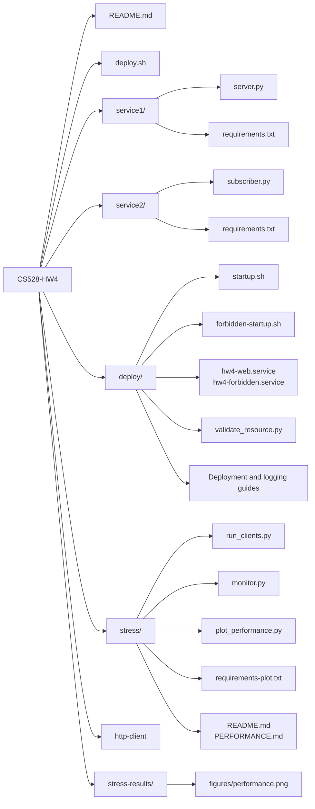

# CS528 HW4

## 1. Overview

Building on HW3, this project migrates the file-serving and banned-country reporting services to Google Cloud virtual machines. The Python web server retrieves Cloud Storage files through HTTP GET/POST requests and publishes banned-country events to a Pub/Sub subscriber running on a separate VM. Automated deployment, Cloud Logging, and stress tests with up to four concurrent clients support deployment and performance evaluation.

## 2. File Structure



## 3. How to Start

### Deploy to Google Cloud

Run these commands from the project root on your local machine. You need Python 3, the Google Cloud CLI, an existing project with billing enabled, an existing HW2 bucket containing the files, and an account authorized to provision resources and configure IAM.

```bash
gcloud auth login
chmod +x deploy.sh
PROJECT_ID=cs-528-508021 BUCKET_NAME=cs528hw2 ./deploy.sh
```

The script configures service accounts, IAM, Pub/Sub, a static external IP, firewall rules, and both service VMs. Startup scripts install dependencies and start the applications through systemd without manual SSH setup. The bucket must use uniform bucket-level access; see the [deployment guide](deploy/AUTOMATION.md) for configuration options and ACL migration considerations.

Existing VMs are reused without restarting or updating their application code by default. To deploy updated code to existing VMs, run the following after any ongoing tests have finished:

```bash
PROJECT_ID=cs-528-508021 UPDATE_EXISTING=true ./deploy.sh
```

New Web Server VMs default to `f1-micro`; existing VMs retain their machine type unless explicitly configured otherwise. If your course configuration requires E2, set `SERVER_MACHINE_TYPE=e2-micro` when creating the VM.

Wait for the startup scripts to finish using the log commands printed by the deployment script. Then request an existing file using the server's static IP:

```bash
curl -i http://STATIC_IP:8080/8069.html

curl -i http://STATIC_IP:8080/ \
  -H 'Content-Type: application/json' \
  -d '{"filename":"8069.html"}'
```

Replace `STATIC_IP` with the deployed address and `8069.html` with an existing filename. By default, filenames are relative to `gs://cs528hw2/pages/`.

### Run the Web Server Locally

```bash
python3 -m venv .venv
source .venv/bin/activate
python -m pip install -r service1/requirements.txt
gcloud auth application-default login

export GOOGLE_CLOUD_PROJECT=cs-528-508021
export BUCKET_NAME=cs528hw2
export OBJECT_PREFIX=pages
python3 service1/server.py
```

The server listens on `http://localhost:8080`. The local ADC identity needs permission to read the bucket objects and, for banned-country notifications, publish to the configured Pub/Sub topic. Cloud Logging is enabled by the VM startup script; local execution defaults to console output.

## 4. Stress Test Performance


## 5. AI Disclosure

I used AI for consultant and debugging. Frankly I am really poor in writing .sh and scripts, so it took me a long time to finish and I referenced AI a lot. I also used AI in gernerating the graph (plot_performance.py) file.